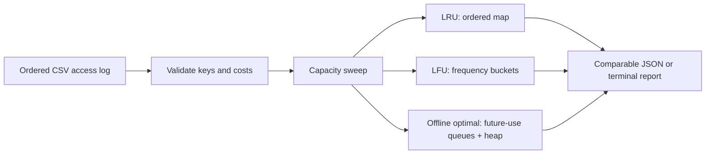

# CacheTrace

[](https://github.com/brohum10/cachetrace/actions/workflows/ci.yml)

**Would a different cache policy actually help your workload? Replay the trace before guessing.**

CacheTrace compares least-recently-used (LRU), least-frequently-used (LFU), and Belady's offline optimal policy over the same access log and capacity sweep. It reports hits, misses, first-access misses, and a user-supplied miss-cost estimate. Everything runs locally with the Python standard library.

This is an educational workload-analysis tool, not a cache server or a production capacity recommendation.

## Try it in 30 seconds

Python 3.11 or newer; no API key, account, or runtime dependencies.

```sh
python3 cachetrace.py examples/requests.csv --capacities 0 2 4
python3 cachetrace.py examples/requests.csv --capacities 2 4 --json
python3 -m unittest discover -s tests -v
```

Optional installed command:

```sh
python3 -m venv .venv
.venv/bin/python -m pip install .
.venv/bin/cachetrace examples/requests.csv --capacities 2 4
```

Windows: use `.venv\Scripts\python.exe` and `.venv\Scripts\cachetrace.exe`.

## Input and output

CSV requires a `key` column, optionally `miss_cost`. Each row is one access, already in chronological order. Costs default to 1 and must be finite and nonnegative. Quoted CSV keys can contain commas. Blank keys, duplicate/unknown headers, ragged rows, and invalid costs fail with exit status 2 instead of producing a misleading report. Keys are case-sensitive and are preserved exactly.

```csv
key,miss_cost
product:42,12
product:17,8
product:42,12
```

Cost is charged only on a miss. If weights are milliseconds, the sum is a **serial additive estimate**, not measured latency: it ignores concurrency, overlap, batching, and queueing. Belady minimizes **miss count**, not weighted cost. With varying weights, another policy can have fewer total cost units even with more misses.

JSON includes the model assumptions and one result per unique capacity/policy pair, sorted by capacity. Empty traces return zero counts and zero hit rate. At capacity zero every request misses. Compulsory misses count distinct keys under cold start.

## How it works



| Policy | Eviction rule | Important trade-off |
| --- | --- | --- |
| LRU | Evict the least recently accessed resident | Adapts to changing demand but scans can evict useful keys |
| LFU | Evict the least frequently accessed resident; LRU breaks ties | Resists some scans but old hot keys can remain after demand changes |
| Optimal | Evict the resident used farthest in the future | Unimplementable online; provides a minimum-miss reference for this model |

LFU frequencies are **resident-only**: eviction forgets a key's count. There is no aging. All policies start empty, cache equal-size entries, and admit every missed item when capacity is positive. There are no TTLs, writes, invalidations, prefetching, or admission bypasses. Optimal is a lower bound only under these same assumptions.

LRU and LFU use expected O(1) work per access. Optimal precomputes future access queues, then uses a lazy max-priority heap with periodic rebuilding to keep heap storage O(capacity); replay is amortized O(n log(capacity + 1)) with O(n) future-trace storage. The CLI holds the entire trace in memory and replays it separately for each capacity and policy, so it is not a streaming large-log engine.

## Correctness evidence

- Exhaustive traces over three keys, lengths 0–6, and capacities 0–3 compare Belady against an independent recursive dynamic-programming solver: **4,372 trace/capacity combinations**.
- Seeded LFU differential tests compare frequency buckets against a simple reference across 7,000 accesses.
- Tests cover the LRU capacity monotonicity property, LFU tie-breaking, phase changes, scan resistance, bounded optimal-heap storage, weighted costs, overflow, CSV validation, and CLI behavior.
- GitHub Actions tests Python 3.11 and 3.13 and smoke-tests the installed command.

Tests demonstrate behavior for the model; they do not establish production suitability.

## Reproducible benchmark

```sh
python3 benchmark.py --requests 100000 --runs 5 --output benchmark-results.json
```

The seeded workload mixes a hot set, periodic scan keys, and a mid-trace hot-set change. The report records all samples, Python/platform information, hits, and hit rate for a 256-entry cache. It includes input validation and optimal preprocessing but excludes CSV I/O. See [benchmark-results.json](benchmark-results.json) for one local run. Timing depends on hardware and interpreter; cache hits here are simulated, not observed production savings.

## What I would extend next

- TTL and object-size-aware models with explicitly different optimal-reference assumptions.
- LFU aging and admission policies to handle hot-set shifts.
- Real sanitized workload evaluation, with train/evaluation trace separation before choosing a policy.
- Streaming LRU/LFU replay for logs too large to retain in memory.

Built as a learning and portfolio project with AI assistance. MIT licensed.
